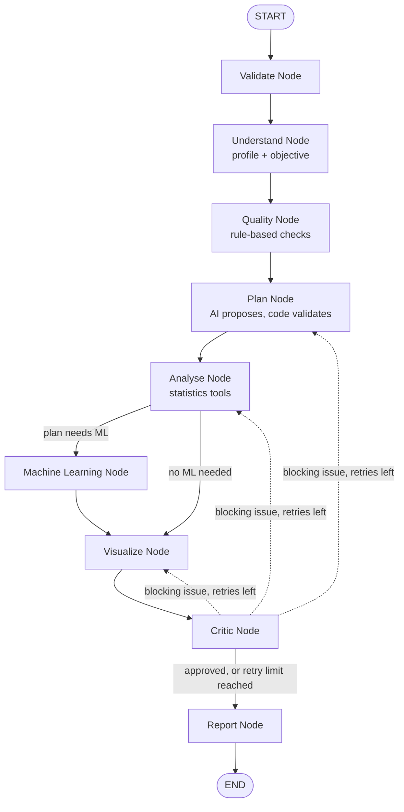

# ByteFlow — Autonomous AI Data Analyst

An agentic data-analysis assistant that accepts structured datasets (CSV or Excel) and natural-language queries to execute, evaluate, and report statistical and machine-learning workflows under explicit programmatic constraints.

> **Key Architectural Takeaway:** The AI plans and interprets, while deterministic, tested Python code executes every calculation, ensures statistical validity, and validates generated metrics before report assembly.

---

## 1. Overview & Problem Statement

Exploratory analysis and data modelling require multiple manual, error-prone steps: data-quality auditing, statistical test selection, assumption validation, leakage-free modelling, visualisation, and technical reporting.

Standard "chat with your data" solutions often execute arbitrary code or rely on LLM-driven arithmetic, introducing risks such as hallucinated metrics, data leakage, code injection, and prompt manipulation.

ByteFlow addresses these failure modes by separating reasoning from computation:

- **Zero dynamic code execution:** The LLM selects actions from a strictly controlled schema; deterministic functions perform all computations.
- **Fact-checked outputs:** Numerical values appearing in generated narratives are verified against pre-computed tool outputs.
- **Leak-safe ML pipelines:** Data transformation, baseline comparisons, cross-validation, and holdout evaluations follow scikit-learn pipeline standards.

## 2. Core Architecture & Workflow

The system is organised as an orchestrated state graph managed using **LangGraph**. Workflows proceed through distinct state nodes, incorporating rule-based fallbacks and automated critic checks.

### Agent Roles & Capabilities

| Agent / Node | Primary Responsibility | LLM Driven? | Security & Validation Controls |
|---|---|---|---|
| **Validate** | Assesses file structure, bounds, and query validity | No | Rejects malformed requests before LLM invocation |
| **Understand** | Summarises schema, column types, and objectives | Yes | Receives sanitised column summaries, not raw data rows |
| **Quality** | Identifies missingness, duplicates, outliers, and data-type anomalies | No | Uses deterministic rules, including IQR and placeholder checks |
| **Plan** | Proposes statistical tests and modelling strategies | Yes | Proposals are validated against dataset metadata |
| **Analyse** | Executes requested statistical tests | No | Performs hypothesis testing with assumption checks and effect sizes |
| **Machine Learning** | Trains baselines and candidate models; evaluates feature importance | No | Enforces leak-safe transformations, cross-validation, and holdout evaluation |
| **Visualize** | Generates relevant static charts | No | Uses deterministic Matplotlib/Seaborn plotting |
| **Critic** | Evaluates analytical completeness and structural integrity | Partial | Enforces execution limits and verifies output sanity |
| **Report** | Compiles the structured analytical report | Yes | Validates narrative claims against numerical tool outputs |

## 3. Key Features

### Automated Data Quality Auditing
- Detects missing entries and duplicate rows.
- Identifies numerical outliers using the IQR method.
- Checks data-type mismatches and inconsistent categorical values.
- Detects sentinel placeholder values, such as `999`.

### Context-Aware Hypothesis Testing
Automatically selects suitable parametric or non-parametric tests based on data characteristics and assumptions.

- **Correlation:** Pearson and Spearman correlation, with multiple-testing corrections.
- **Group comparisons:** Welch's t-test, Mann–Whitney U, ANOVA, Kruskal–Wallis, Chi-square, and Fisher's exact test.
- **Outputs:** Test statistics, p-values, effect sizes, and explanations.

### Leak-Safe Machine Learning
- Automatic task routing for classification, regression, and clustering.
- Baseline comparisons and candidate-model evaluation.
- Cross-validation and final holdout-set evaluation.
- Permutation feature importance.
- Automated overfitting and weak-model warnings.

### Interactive Analysis Export
ByteFlow provides a dedicated **Export Analysis** tab with a format selector and a single download button.

Supported export formats:

| Format | Extension | Description |
|---|---|---|
| PDF | `.pdf` | Portable analytical report |
| Word | `.docx` | Editable report document |
| PowerPoint | `.pptx` | Presentation-ready report |
| Excel | `.xlsx` | Spreadsheet report |
| CSV | `.csv` | Tabular analytical output |
| Markdown | `.md` | Markdown report |

PDF, Word, and PowerPoint exports can include generated chart images where available.

### Fail-Safe Resilience
Includes rule-based plan fallbacks if the LLM provider experiences downtime or API limits.

## 4. Technical Stack

- **Language:** Python 3.12+
- **Orchestration:** LangGraph
- **Data validation:** Pydantic
- **Data processing:** Pandas, NumPy
- **Statistical analysis:** SciPy, statsmodels, scikit-learn
- **Visualisation:** Matplotlib, Seaborn
- **User interface:** Streamlit
- **LLM integration:** OpenAI SDK (compatible with Groq, Google Gemini, OpenRouter, and OpenAI)
- **Export generation:** ReportLab, python-docx, python-pptx, openpyxl

## 5. Using ByteFlow

1. Launch the Streamlit application.
2. Upload a supported CSV or Excel dataset.
3. Enter a natural-language question or analysis objective.
4. Run the analysis.
5. Review the generated report, data-quality findings, statistical results, machine-learning results, charts, and workflow log.
6. Open the **Export Analysis** tab.
7. Select your preferred file format from the dropdown.
8. Click **Download** to export the analysis.

## 6. System Specifications & Security

### File and Data Handling Limits

- **Supported input formats:** `.csv` and `.xlsx` (first worksheet).
- **Dataset capacity:** Up to 200,000 rows and 200 columns.
- **Execution storage:** In-memory dataset handling with automatically cleared temporary artifacts.

### Security Highlights

- **No unsafe code execution:** The LLM does not write or execute Python scripts.
- **Privacy controls:** Raw dataset rows are not sent to external LLM endpoints; only aggregated metadata and column signatures are transmitted.
- **Injection mitigation:** Dataset headers and content strings are sanitised before display or prompt insertion.
- **Excel safety:** Formula evaluation is disabled.
- **Error handling:** User-facing errors do not expose stack traces or secrets.

## 7. Known Scope & Limitations

- **Analytical boundaries:** Focuses on tabular classification, regression, clustering, and fundamental bivariate and multivariate statistics. Time-series forecasting and complex NLP pipelines are outside its current scope.
- **Observational limitations:** Results describe statistical associations and predictive patterns, not necessarily causal relationships.
- **Input limitations:** Excel processing currently uses the first worksheet.
- **LLM dependency:** AI-assisted interpretation and planning require a correctly configured provider API key. Rule-based fallbacks help maintain resilience during provider interruptions.

---

**ByteFlow — Turning natural-language questions into structured, validated data analysis.**