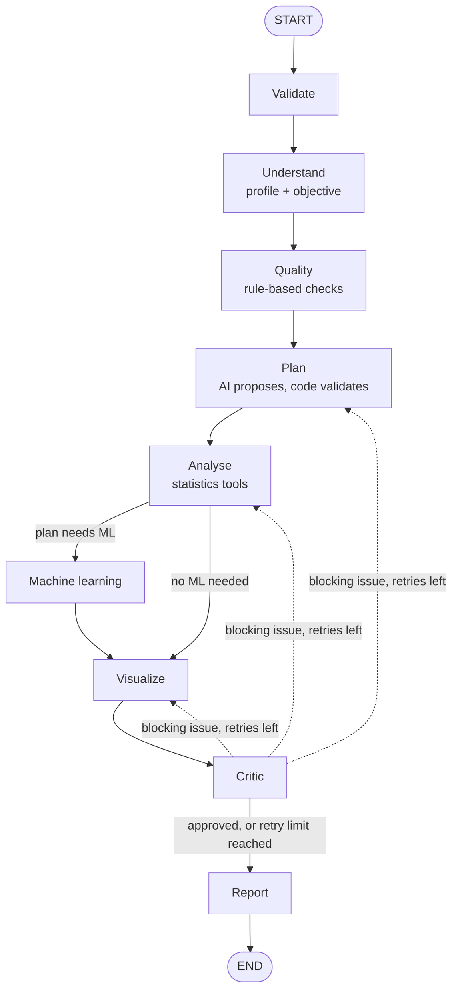

# Autonomous AI Data Analyst

An agentic data-analysis assistant. Upload a CSV or Excel file, ask a question in plain English, and a team of
specialised agents **plans, runs, checks and reports** a statistical and machine-learning analysis, with the AI
kept on a short, safe leash.

> Built with Python, LangGraph, scikit-learn, SciPy/statsmodels and Streamlit. Works with a **free** API key (Groq or
> Google Gemini). 147 automated tests. See [SECURITY.md](SECURITY.md) for the threat model and an honest checklist.

## 1. Introduction

Most "chat with your data" demos let an AI write and run code on your file. This project does the opposite on purpose:
the AI **plans and explains**, but every calculation is done by ordinary, tested Python functions, and every number in
the report comes from those calculations.

## 2. Problem statement

Exploratory analysis is repetitive: check quality, pick suitable tests, avoid statistical mistakes, build a fair
model, make charts, write it up. This project automates that workflow while guarding against the usual failure modes of
LLM-based tools: invented numbers, unsafe code execution, data leakage in machine learning, and prompt injection from
untrusted data.

## 3. Main features

- **Dataset checks:** missing values, duplicates, outliers (IQR), numbers stored as text, mixed types, inconsistent
  categories, placeholder codes such as 999.
- **Chooses its own analysis:** the planner picks only tests that fit the columns and the question. Invalid or
  inappropriate steps are dropped by code.
- **Statistics with assumption checks:** Pearson or Spearman correlation (with multiple-testing correction), Welch's
  t-test, Mann-Whitney, ANOVA, Kruskal-Wallis, chi-square or Fisher's exact test, with effect sizes and a stated reason
  for each test.
- **Honest machine learning:** classification, regression or clustering; leak-proof pipelines; a baseline model;
  cross-validation; one final look at a held-out test set; permutation importance; overfitting and weak-model warnings.
- **A Critic agent** that reviews results and can send work back, with a hard retry limit.
- **An 11-section report** plus charts, downloadable from the app.
- **Fails safely:** if the AI is unavailable the analysis still completes with a rule-based plan, and the report says so.

## 4. Technologies used

| Technology | Role |
|---|---|
| Python 3.12+ | Language |
| LangGraph | Orchestrates the agents as a state graph |
| `openai` SDK | Talks to any OpenAI-compatible provider (Groq, Gemini, OpenRouter, OpenAI) |
| Pandas, NumPy | Data handling |
| scikit-learn | Pipelines, models, cross-validation, clustering |
| SciPy, statsmodels | Hypothesis tests, multiple-testing correction |
| Matplotlib, Seaborn | Charts (saved as PNG) |
| Streamlit | User interface |
| Pydantic | Validation of settings and of every AI answer |
| python-dotenv, openpyxl, filetype | Settings, Excel reading, file-type detection |
| pytest | 147 automated tests |

Deliberately **not** used: LangChain beyond what LangGraph needs internally, and Plotly (static PNG charts are easy to
download and embed). Fewer dependencies means a smaller attack surface.

## 5. Agent architecture



| Agent | Job | Uses the AI? |
|---|---|---|
| Validate | Rejects empty data or an invalid question before any AI call | No |
| Understand | Profiles columns and states the objective | Yes (sees only a sanitized summary) |
| Quality | Missing values, duplicates, outliers, type problems, cleaning advice | No |
| Plan | Chooses analysis steps from a fixed menu; code then validates every step against the real data | Yes, then validated by code |
| Analyse | Runs the planned tests | No |
| Machine learning | Leak-safe models, honest evaluation | No |
| Visualize | A capped set of relevant charts | No |
| Critic | Rule checks plus an advisory AI review of the computed numbers | Partly |
| Report | Assembles 11 sections; AI writes only words, checked against the numbers | Yes, then verified |

## 6. How the workflow works

1. **You upload a file.** It is checked by content, size and structure, and kept in memory only.
2. **Validate, Understand, Quality.** The data is profiled. Only column names, types and statistics are described to
   the AI, never raw rows.
3. **Plan.** The AI proposes steps such as `correlation` or `group_comparison`. Your own code removes anything that
   does not fit the data (wrong column types, unknown columns, too many groups) and can switch machine learning off
   if the target is unusable.
4. **Analyse and (maybe) Machine learning.** Fixed Python functions run. Machine learning happens only when the plan
   needs it.
5. **Critic.** If results are missing or impossible, it sends the work back to the planner (or another step) with
   feedback. **At most `MAX_RETRIES` times (default 2)**, plus a second safety limit inside LangGraph.
6. **Report.** Every table and number is built from calculations. Any AI sentence containing a number that was not
   calculated is replaced. Fallbacks and warnings are listed in the report's Limitations.

## 7. Project structure

```
autonomous-data-analyst/
├── app.py                  Streamlit interface
├── requirements.txt        Pinned dependencies
├── .env.example            Template for your settings (the real .env is git-ignored)
├── pytest.ini  .gitignore  SECURITY.md  README.md
├── .streamlit/config.toml  Upload limit, XSRF protection, no telemetry
├── agents/                 The LangGraph workflow
│   ├── state.py            Shared state + Pydantic schemas for AI answers
│   ├── graph.py            Nodes, conditional edges, retry routing, error recovery
│   ├── llm.py              Provider client: timeouts, retries, JSON validation, safe errors
│   ├── understanding.py  quality.py  planner.py  analyst.py
│   └── ml_agent.py  visualization.py  critic.py  reporter.py
├── tools/                  Plain, tested Python functions (no AI)
│   ├── data_inspection.py  data_cleaning.py  statistics.py
│   └── machine_learning.py  visualization.py  report_generation.py
├── utils/                  config, security helpers, validation, logging, app helpers
├── tests/                  147 tests (+ conftest.py with a fake LLM)
├── sample_data/            generate_sample_data.py creates demo datasets
└── outputs/                Per-session chart folders (auto-deleted)
```

## 8. Installation

You need **Python 3.12 or newer** (the pinned NumPy and SciPy require it). Check with `python --version`.

**Windows (PowerShell), from the project folder:**
```
python -m venv .venv
.venv\Scripts\Activate.ps1
pip install -r requirements.txt
copy .env.example .env
```

**macOS / Linux:**
```
python3 -m venv .venv
source .venv/bin/activate
pip install -r requirements.txt
cp .env.example .env
```

If PowerShell blocks the activate script, run `Set-ExecutionPolicy -Scope CurrentUser RemoteSigned` once.

## 9. API key configuration

Any OpenAI-compatible provider works. Pick one and put its three lines in `.env`:

| | Groq | Google Gemini |
|---|---|---|
| Get a key | console.groq.com | aistudio.google.com |
| `LLM_BASE_URL` | `https://api.groq.com/openai/v1` | `https://generativelanguage.googleapis.com/v1beta/openai/` |
| `LLM_MODEL` | `openai/gpt-oss-120b` | `gemini-2.5-flash` |

```
LLM_API_KEY=your-real-key
LLM_BASE_URL=https://api.groq.com/openai/v1
LLM_MODEL=openai/gpt-oss-120b
```

- Never commit `.env`. It is already in `.gitignore`. Never paste the key into code or into a chat.
- Free tiers and model names change. If you see "model not found", copy a current model name from your provider.
- **Free tiers may use your data.** Upload only public or synthetic data.
- Optional limits in `.env`: `MAX_UPLOAD_MB` (default 20; also set `maxUploadSize` in `.streamlit/config.toml`),
  `MAX_RETRIES` (default 2), `LLM_TIMEOUT_SECONDS` (default 60).

## 10. Running the project

```
python -m streamlit run app.py
```

Open the address it prints (normally http://localhost:8501). In the sidebar you should see a green "Key found" box.
Stop the server with `Ctrl+C`.

## 11. Example usage

Create the demo data (synthetic, with planted problems for the agent to find):

```
python sample_data/generate_sample_data.py
```

1. Upload `sample_data/customer_churn.csv` (or the `.xlsx` copy).
2. Try these questions:
   - *Find missing values, duplicates and outliers.*
   - *Identify correlations between the numeric variables.*
   - *Does monthly_charges differ between contract types?*
   - *What are the most important factors influencing churn? Build a suitable model.*
   - *Group similar customers into segments.*
3. Watch the progress box, then open the tabs: **Report**, **Data quality**, **Statistics**, **Machine learning**,
   **Charts**, **Workflow log**. Download the report (`.md`) and the charts (`.zip`).

**What to expect.** The churn file has 12 duplicate rows, 45 missing `monthly_charges` values, 30 missing `region`
values and two 999.99 placeholder outliers; the Data quality tab should show them. For the modelling question, the
target should be `churn` (classification). In my own test run of the built-in rule-based plan (no AI involved), the best
model was logistic regression with a balanced accuracy of about 0.75 against a 0.50 baseline. For
`housing_prices.csv` ("Predict price and find the most important factors") the same run gave a regression R² of about
0.93. Your numbers can differ a little, and the AI's wording will differ from run to run.

## 12. Testing

```
python -m pytest
```

Expected: **147 passed** (35 security, 40 tools, 40 agents, 18 workflow, 4 app helpers, 10 interface). It takes a few
minutes because the workflow tests run real machine learning. Add `-W ignore` to hide harmless library warnings.

Every test uses a scripted **fake LLM**, so the suite needs no API key and costs nothing. This also means **no test
proves how a real provider behaves**: try the app with your key to check that. Failure paths are tested with real
HTTP error objects and an unreachable address.

Optional security scans (install the tools first with `pip install bandit pip-audit`):
```
bandit -r agents tools utils app.py
pip-audit --local
```

## 13. Security considerations

Highlights (full detail and a PASS / FAIL / NOT VERIFIED checklist in [SECURITY.md](SECURITY.md)):

- Uploads are validated by content, size, rows, columns and zip-bomb checks; Excel formulas are never evaluated.
- The AI never runs code and never receives raw rows; its answers are schema-validated and limited to a fixed menu.
- Dataset text is escaped everywhere it is displayed; there is no `unsafe_allow_html`.
- The API key is never logged or shown. Errors shown to users contain no stack traces.
- Data stays in memory; chart folders are deleted on "Clear my data" and after 24 hours.

## 14. Known limitations

- A **single-user local demo**: no login, not hardened for the public internet.
- No wall-clock timeout or memory cap on an analysis; a very large valid file can be slow and cannot be interrupted.
- Reads `.csv` and the **first sheet** of `.xlsx` only (not `.xls`/`.xlsm`); up to 200,000 rows and 200 columns.
- Statistics are limited to the six built-in actions; no time-series analysis, no hyperparameter tuning.
- Results show associations, not causes. A real LLM can still write misleading prose even though invented numbers
  are blocked.
- Tested with a fake LLM only; real-provider behaviour (and prompt-injection resistance) is not verified by the suite.

## 15. Future improvements

Authentication and per-user quotas; a worker process with CPU, memory and time limits; time-series and text
columns; hyperparameter search and model explanations (SHAP); a dataset-download option with sanitised export;
hash-pinned dependencies and CI with `pip-audit`; a small evaluation set to measure real-LLM plan quality;
Docker packaging.

## Troubleshooting

| Symptom | Likely cause and fix |
|---|---|
| `ModuleNotFoundError` for `agents`, `tools` or `utils` | Run commands from the project folder, and check each package folder has an `__init__.py` |
| Sidebar says "No API key" | `.env` is missing, unsaved, or still says `your-key-here`. Restart the app after editing it |
| "The AI provider rejected the request (HTTP 400): ..." | The message includes the provider's reason: usually a wrong `LLM_MODEL` or a limit being exceeded |
| "rate limit was reached" | Free-tier quota. Wait a minute, or use another model |
| `streamlit` is not recognised | Use `python -m streamlit run app.py` with the virtual environment active |
| pytest fails to collect files you did not create | Remove leftover files from an older version of the project |