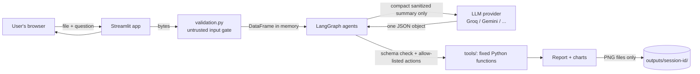

# Security

This document describes how the Autonomous AI Data Analyst is protected, what was actually verified, and what is
**not** protected. It is written to be honest: a claim appears as PASS only if a test, a scan or a code search backs it.

*Last reviewed: 5 November 2026. Scan results are a snapshot of that day.*

## 1. Summary

- Uploaded files are treated as **untrusted input**. They are validated by content, size and structure, parsed in memory,
  and never written to disk.
- The LLM **never runs code and never sees raw rows**. It receives a small sanitized summary (column names, types,
  counts, computed statistics) and must answer with one JSON object that is validated against a schema. All data
  operations are fixed Python functions chosen from a short allow-list.
- Numbers in the report come from calculations. AI-written text is checked against the computed numbers, and
  statements containing numbers that were not calculated are dropped.
- This is a **single-user, local demo application**. It has no login, no encryption of data in memory, and it is
  **not** hardened for use by many untrusted users on the public internet (see section 6).

## 2. Architecture and trust boundaries

| Boundary | What crosses it | Protection |
|---|---|---|
| Browser to app | File bytes, question text | Extension, content, size, row and column checks; question length and control-character cleanup |
| App to LLM provider | Column names, types, counts, computed statistics | Sanitized and truncated text inside `<untrusted_...>` tags; **no raw cell values** |
| LLM to app | One JSON object | Pydantic schema, fixed action names, column names re-mapped to real columns, invalid steps dropped |
| App to disk | Chart PNGs only | Random file names, inside a per-session folder, path-traversal check, deleted on clear and after 24 hours |

## 3. Threat model

**Assets:** the API key; the uploaded data; the machine running the app; the integrity of the analysis report.

| Threat | Mitigation | Evidence |
|---|---|---|
| Disguised or malicious upload (wrong type, binary junk, corrupt file) | Extension allow-list (`.csv`, `.xlsx`), real-content check, safe parse | `test_security.py`: bad extensions, PNG named `.csv`, fake and corrupt `.xlsx`, binary CSV |
| Zip bomb inside `.xlsx` | Total uncompressed size and entry count are checked before parsing | `test_zip_bomb_rejected` |
| Oversized file or dataset | Byte, row and column limits | `test_oversized_file_rejected`, `test_row_and_column_limits` |
| Excel formulas executing | Workbooks are read for cached values only; formulas are never evaluated | `test_xlsx_formulas_are_never_evaluated` |
| Formula injection in exported files | Cells starting with `= + - @` are prefixed with `'` | `test_formula_payloads_neutralized`, `test_export_sanitizes_headers_and_cells` |
| Path traversal and file-name tricks | Uploads are never stored by name; chart names are random; every path is resolved and checked | `test_path_traversal_blocked`, `test_safe_filenames`, `test_read_chart_bytes_only_serves_pngs_inside_the_session` |
| Prompt injection (text in cells or column names) | Cell values are never sent; column names are sanitized, truncated and wrapped in untrusted tags; every system prompt says to ignore instructions in that data; the answer is schema-validated | `test_no_prompt_ever_contains_raw_data`, `test_prompt_injection_in_data_cannot_change_the_workflow`, `test_malicious_column_names_are_sanitized_in_prompts` |
| LLM asked (or tricked) into running code or reading files | The LLM can only return JSON. Plan steps map to fixed functions; unknown actions or columns are dropped | `test_unsafe_step_content_is_never_executed`, `test_validate_plan_drops_invalid_steps` |
| Fabricated numbers in the report | The AI writes words only; numbers are checked against computed results at the precision written; unsupported statements are replaced | `test_number_grounding`, `test_reporter_drops_fabricated_numbers_and_neutralises_html` |
| HTML or Markdown injection through dataset text | No `unsafe_allow_html`; dataset-derived text is escaped before Markdown rendering; AI text has `<` and `>` neutralised | `test_report_escapes_malicious_content`, `test_hostile_column_names_cannot_inject_html_into_the_report` |
| API key leakage | Key lives in `.env` (git-ignored), is a `SecretStr`, is redacted by exact value in LLM errors and by pattern in logs | `test_redaction_and_safe_errors`, `test_log_filter_redacts`, `test_settings_hide_api_key`, `test_llm_http_400_keeps_status_and_provider_reason_without_leaking_key` |
| Stack traces and internals shown to users | Every node and the UI catch exceptions and show a generic message; only the exception type is logged | `test_node_crash_becomes_a_clean_failure`, `test_invalid_env_settings_show_a_friendly_error_not_a_traceback` |
| Runaway loops and cost | Retry limit, graph recursion limit, run cooldown and per-session cap, LLM timeout, ML row cap | `test_critic_loop_is_bounded_by_max_retries`, `test_run_limiter_cooldown_and_cap` |
| Data kept longer than needed | Memory only for the dataset; chart folders deleted on "Clear my data", on a new upload, and after 24 hours | `test_clear_my_data_deletes_everything`, `test_purge_removes_only_old_session_folders` |
| One session reading another's results | Session state and output folders are separate; session IDs are random 128-bit values validated before use | `test_sessions_are_isolated`, `test_session_dirs_are_isolated_and_validated` |

## 4. Verification performed

| Check | Result |
|---|---|
| Automated tests | **147 tests**: 35 security, 40 tools, 40 agents, 18 workflow, 4 app helpers, 10 interface (run headlessly). All use a scripted fake LLM, so **no test contacts a real AI provider** |
| Static analysis (`bandit -r agents tools utils app.py`) | 2,705 lines scanned, **0 issues** at any severity |
| Dependency audit (`pip-audit --local`) | **No known vulnerabilities** in the installed, pinned packages (snapshot: 5 Nov 2026) |
| Code search for `eval`, `exec`, `subprocess`, `os.system`, `pickle`, sockets, HTTP libraries | **None** outside the LLM client (the only code that makes network calls). `re.compile` and LangGraph's `compile()` are the only matches for the word "compile" |
| Code search for hardcoded keys and `unsafe_allow_html` | None in code; the two mentions in `app.py` are comments |
| Server start-up | `streamlit run app.py` starts and answers its health check |

You can repeat these checks yourself (see the README).

## 5. Security checklist

Statuses: **PASS** = backed by a test, scan or code search listed above. **FAIL** = a requirement that is not met.
**NOT VERIFIED** = implemented or configured, but not demonstrated.

### File upload
| Item | Status | Notes |
|---|---|---|
| Accept only CSV and Excel | PASS | `.csv` and `.xlsx` only. Legacy `.xls` and macro-enabled `.xlsm` are rejected on purpose |
| Validate extension **and** real content | PASS | |
| Limit upload size | PASS | `MAX_UPLOAD_MB` (default 20) plus row and column limits |
| Streamlit's own upload cap (`.streamlit/config.toml`) | NOT VERIFIED | Configured; not tested against a running server |
| Prevent path traversal; safe internal file names | PASS | Uploads are never written to disk |
| Reject unsupported, malformed or corrupted files gracefully | PASS | |
| Prevent spreadsheet formula execution | PASS | |

### Code execution
| Item | Status | Notes |
|---|---|---|
| No `eval()` / `exec()`; no LLM-generated code executed | PASS | Code search, bandit, and design |
| No arbitrary shell commands; no filesystem access for the LLM | PASS | |
| No network requests from analysis tools | PASS | Only the LLM client uses the network, to the operator-configured `https://` URL |
| Only predefined, validated functions | PASS | |

### API and credentials
| Item | Status | Notes |
|---|---|---|
| Key from environment; never hardcoded; `.env.example`; `.env` ignored | PASS | |
| Key not exposed in logs or error messages | PASS | Exact-value redaction in LLM errors; **pattern-based** redaction elsewhere (`sk-...`, `Bearer ...`, `api_key=...`). A key in an unexpected format printed by some other library would not be caught |
| Safe error handling | PASS | |

### Dataset
| Item | Status | Notes |
|---|---|---|
| Treat uploads as untrusted; text is data, not instructions | PASS | Structural defences are tested |
| Resistance of a **real** model to prompt injection | NOT VERIFIED | Tests use a fake LLM. The schema, allow-list and validation limit the damage a manipulated answer can do, but they cannot guarantee a real model will ignore injected text |
| Do not transmit the full dataset to the LLM | PASS | Canary tests |
| Minimise sensitive data sent | PASS | By design: **column names, types, counts and computed statistics are still sent**, so a sensitive column name or aggregate leaves your machine |
| Do not retain datasets longer than necessary | PASS | Memory only; charts deleted as described. Streamlit's own in-memory handling of an uploaded file until the session ends is NOT VERIFIED |
| Isolation between user sessions | PASS | Separate per-session memory and folders, tested |
| Isolation under real concurrent multi-user load, or against a hostile user | NOT VERIFIED | No authentication exists. See section 6 |

### Application
| Item | Status | Notes |
|---|---|---|
| Validate user input | PASS | |
| Formula injection protection for exports | PASS | The report is Markdown and charts are PNGs. The CSV export helper is sanitised and tested, but the interface does not offer a dataset download |
| Avoid unsafe HTML rendering | PASS | |
| No stack traces shown | PASS | |
| Input-size, iteration, retry and API-timeout limits | PASS | |
| **Wall-clock timeout or memory cap on the analysis itself** | **FAIL** | Not implemented. A large, valid dataset can make an analysis slow, and it cannot be interrupted |
| Safe temporary-file handling | PASS | The only files written are session charts, cleaned up as described |
| Streamlit XSRF protection | NOT VERIFIED | Enabled in config; not tested against a running server |
| Dependency vulnerabilities | PASS | Snapshot only. Re-run `pip-audit` regularly |
| Hash-pinned dependencies | FAIL | Versions are pinned, hashes are not |
| Manual penetration test | NOT VERIFIED | Not performed |

## 6. Known limitations (read before using)

1. **No authentication or multi-tenant hardening.** Run it locally. Do not expose it to the internet. If you must
   share it, put it behind an authenticating HTTPS reverse proxy and run one instance per trust group.
2. **Free AI tiers may use your data.** Some free plans (for example Google's free Gemini tier) state that prompts can be
   used to improve their products. Use public or synthetic data only. Column names and statistics are sent.
3. **The analysis cannot be interrupted** and has no memory cap (see the FAIL above).
4. **The run limiter is a courtesy**, not abuse protection: reloading the page resets it.
5. **A real LLM can still mislead.** Number grounding stops invented *figures*, not poor reasoning or misleading
   wording. Review the report; the "Workflow log" tab lists every fallback and warning.
6. **Statistics are not magic.** Results describe associations, not causes, and a small or biased file gives weak answers.
   The report says so in its Limitations section.
7. **Not production-ready.** There is no audit logging, rate limiting by user, monitoring or secrets manager.

## 7. Recommended hardening for a real deployment (not implemented)

Authentication (SSO); per-user quotas; a worker process with a CPU, memory and wall-clock limit for each analysis;
hash-pinned dependencies and automated `pip-audit` in CI; a secrets manager; structured audit logs; a provider with
a no-training data agreement; TLS termination and a Content-Security-Policy at the proxy; a professional penetration test.

## 8. Reporting a problem

If you find a vulnerability, please open a private report with the steps to reproduce it. Do not include real
personal data or live API keys in a report.